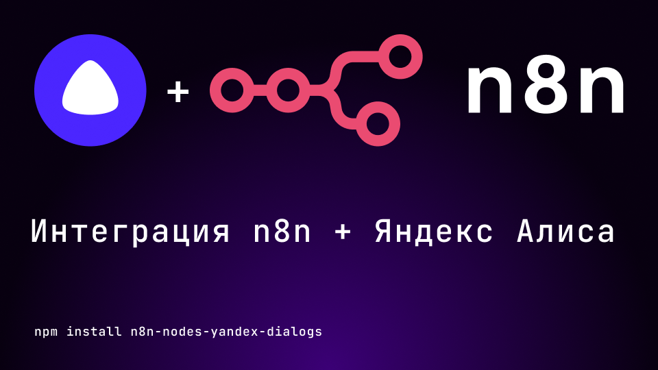
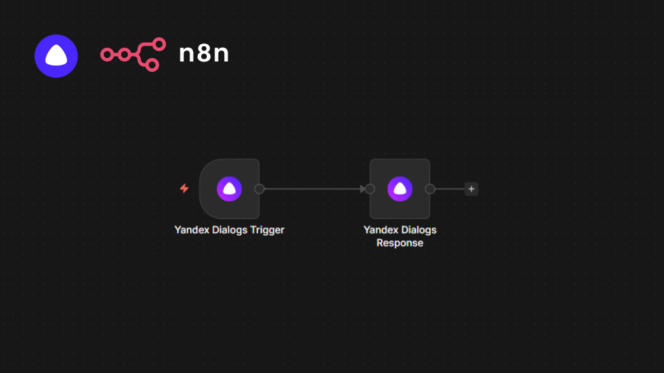
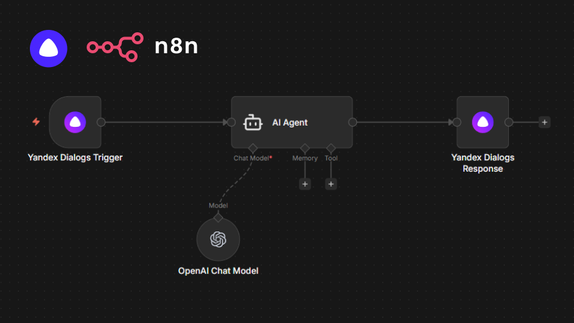

# n8n-nodes-yandex-dialogs

<p align="center">
  
</p>

Интеграция Яндекс Диалогов (голосовой помощник Алиса) для n8n.

Навык Алисы отправляет запросы на webhook-триггер n8n, workflow обрабатывает их (логика, API, AI-модели), а нода ответа формирует корректный ответ Алисе по протоколу Яндекс.Диалогов — с текстом, TTS, кнопками и карточками.

[Установка](#установка) | [Создание навыка Алисы](#создание-навыка-алисы) | [Использование](#использование) | [Примеры](#примеры) | [Разработка](#разработка)

## Возможности

- **Webhook-триггер** для приёма запросов от Алисы с валидацией протокола и фильтрацией пинг-запросов
- **Нормализация запроса**: команда, оригинальная фраза, тип запроса, payload кнопок, NLU-токены/entities/intents, состояние сессии
- **Гибкий ответ**: текст (до 1024 символов), TTS с разметкой, кнопки (до 64 символов в title), карточки BigImage и ItemsList
- **Управление состоянием**: `session_state`, `user_state`, `application_state` — и вход, и выход
- **Аналитика**: данные для Яндекс.Метрики в ответе
- **Режим raw JSON** для полного контроля над ответом

## Установка

### Через Community Nodes (рекомендуется)

1. В n8n откройте **Settings** → **Community Nodes**
2. Нажмите **Install**
3. Введите имя пакета: `n8n-nodes-yandex-dialogs`
4. Подтвердите установку

### Через npm

```bash
npm install n8n-nodes-yandex-dialogs
```

> В self-hosted n8n установленный пакет появится в списке нод после перезапуска.

## Создание навыка Алисы

Перед использованием нод нужно зарегистрировать навык в Яндекс Диалогах и получить URL webhook.

### 1. Разверните n8n с доступом по HTTPS

Протокол Яндекс.Диалогов работает только по HTTPS с валидным сертификатом. n8n должен быть доступен из интернета, например: `https://n8n.example.com`.

Варианты:

- Собственный сервер + reverse proxy (nginx/caddy) с TLS-сертификатом (Let's Encrypt)
- Туннель для разработки: `npx n8n start --tunnel` (даёт временный HTTPS-адрес)

### 2. Создайте workflow в n8n

1. Добавьте ноду **Yandex Dialogs Trigger**
2. В поле **Path** задайте путь webhook, например `alisa-skill`
3. Активируйте workflow

Итоговый URL webhook: `https://<ваш-n8n>/webhook/alisa-skill` — он отображается в параметрах триггера.

> Для отладки используйте URL из режима **Test workflow** (`/webhook-test/...`): Алисе его указывать необязательно, но удобно проверять запросы вручную (curl, Postman).

### 3. Зарегистрируйте навык

1. Откройте [Яндекс Диалоги](https://dialogs.yandex.ru/developer/) и войдите под аккаунтом Яндекса
2. Нажмите **Создать диалог** → **Навык**
3. Заполните настройки:

| Поле | Значение |
|---|---|
| Название | Любое, например «Мой навык n8n» |
| Endpoint | URL webhook из шага 2: `https://<ваш-n8n>/webhook/alisa-skill` |
| Способ подключения | Вебхук |
| Тип | Голосовой ассистент (или Экранный, если нужен экран) |

4. Сохраните черновик

### 4. Проверьте и опубликуйте

1. В консоли разработчика Диалогов откройте **Тестирование** — Яндекс отправит запрос на ваш Endpoint. Если workflow активен, вы увидите выполнение в n8n
2. Тестируйте голосом в приложении Алисы (в консоли навык доступен по имени в режиме черновика)
3. Для публикации заполните требования консоли: описание, иконки, примеры фраз, приватность. Навык может работать и без публикации — в режиме черновика для вашего аккаунта

> Если Яндекс при проверке показывает ошибку — убедитесь, что workflow **активирован** (production-URL `/webhook/...` работает только у активных workflow), а сертификат HTTPS валиден.

## Использование

Минимальная связка — две ноды:

```
Yandex Dialogs Trigger → ... (ваша логика) → Yandex Dialogs Response
```

### Yandex Dialogs Trigger

Принимает POST-запросы навыка и передаёт в workflow нормализованные данные:

| Поле выхода | Описание |
|---|---|
| `command` | Распознанная команда (lowercase, без знаков препинания) |
| `originalUtterance` | Оригинальная фраза пользователя |
| `requestType` | `SimpleUtterance` (фраза) или `ButtonPressed` (кнопка) |
| `buttonPayload` | Payload нажатой кнопки (только для `ButtonPressed`) |
| `isNewSession` | Начало новой сессии |
| `nluTokens` / `nluEntities` / `nluIntents` | Результаты NLU Яндекса |
| `sessionState` / `userState` / `applicationState` | Состояние из предыдущих ответов |
| `hasScreen` | Поддерживает ли устройство экран |
| `rawRequest` | Полный JSON запроса (опция «Include Raw Request») |

Параметры:

- **Path** — путь webhook (итоговый URL: `<n8n-host>/webhook/<path>`)
- **Режим ответа**:
  - *Через узел Yandex Dialogs Response* (рекомендуется) — ответ формируется в конце workflow
  - *Немедленно* — n8n сразу отвечает заглушкой, workflow выполняется асинхронно
- **Опции**: фильтр пинг-запросов (по умолчанию вкл.), валидация версии протокола (вкл.), включение сырого запроса (выкл.)

### Yandex Dialogs Response

Формирует ответ Алисе. Режимы:

| Режим | Назначение |
|---|---|
| **Text** | Текст + TTS + кнопки. Основной режим |
| **BigImage** | Карточка с изображением: ID картинки из [хранилища Диалогов](https://dialogs.yandex.ru/store/), заголовок, описание, кнопка |
| **ItemsList** | Список товаров/статей: элементы с картинками, заголовками и кнопками, с шапкой и подвалом |
| **JSON** | Произвольный JSON-ответ по протоколу (полный контроль) |
| **End Session** | Прощание и завершение сессии |

Общие опции (кроме режима JSON):

- **Session State** (JSON) — данные, вернутся в следующем запросе в `sessionState`
- **Analytics** (JSON) — данные для Яндекс.Метрики

Лимиты протокола соблюдаются автоматически: `text` обрезается до 1024 символов, `title` кнопок — до 64, поля карточек — до своих лимитов.

### Состояние между репликами

Чтобы помнить данные между репликами пользователя, отправляйте `Session State` и читайте `sessionState` из триггера:

```
1-й ответ:  Session State = {"cart": ["молоко"]}
2-й запрос: sessionState.cart = ["молоко"]
2-й ответ:  Session State = {"cart": ["молоко", "хлеб"]}
```

## Примеры

### Пример 1: эхо-навык

<p align="center">
  
</p>

Yandex Dialogs Trigger → Set (`text = Повторяю: {{ $json.originalUtterance }}`) → Yandex Dialogs Response (Text).

### Пример 2: навык с логикой и состоянием

<p align="center">
  
</p>

Пример workflow со счётчиком запросов в рамках сессии:

1. **Yandex Dialogs Trigger** — принимает запрос
2. **Set** — вычисляет ответ, например через `$json.sessionState`:
   - если `isNewSession` — приветствие, иначе ответ по `command`
3. **Yandex Dialogs Response** — Text + Session State `{"count": {{ ... }} }`

### Проверка webhook без Алисы

```bash
curl -X POST https://<ваш-n8n>/webhook/alisa-skill \
  -H "Content-Type: application/json" \
  -d '{
    "version": "1.0",
    "session": {
      "message_id": 0, "session_id": "test", "skill_id": "test",
      "user_id": "test", "new": true
    },
    "request": {
      "type": "SimpleUtterance",
      "command": "привет",
      "original_utterance": "Привет",
      "nlu": {"tokens": ["привет"], "entities": [], "intents": {}}
    },
    "meta": {"locale": "ru-RU", "timezone": "Europe/Moscow", "interfaces": {}}
  }'
```

## Разработка

```bash
npm install        # установка зависимостей
npm run dev        # tsc --watch
npm run build      # clean + tsc + копирование иконок в dist
npm run lint       # eslint по каталогу nodes/
```

Структура пакета:

```
nodes/YandexDialogs/
├── YandexDialogsTrigger.node.ts   # webhook-триггер
├── YandexDialogs.node.ts          # нода ответа
├── types.ts                       # типы протокола Алисы
└── yandex-alisa.svg               # иконка нод
```

## Лицензия

[MIT](LICENSE)
